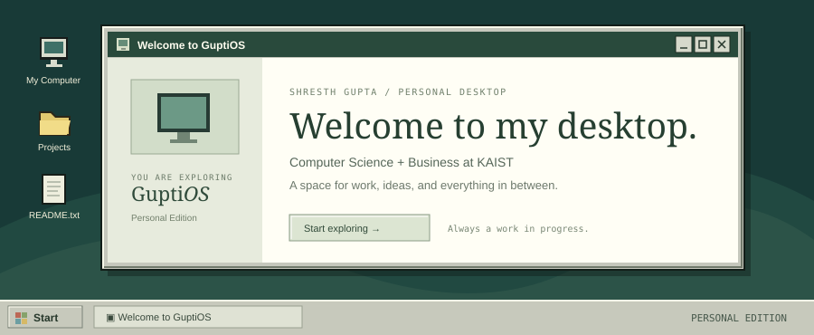

<div align="center">

<a href="https://wiseshrestha.github.io/GuptiOS/">
  
</a>

<sub>PERSONAL EDITION &nbsp; · &nbsp; A LITTLE CORNER OF THE INTERNET</sub>

<br><br>

[🖥️ Open GuptiOS](https://wiseshrestha.github.io/GuptiOS/) &nbsp;&nbsp; · &nbsp;&nbsp; [📁 Explore projects](#-projects) &nbsp;&nbsp; · &nbsp;&nbsp; [👤 About me](#-about-me)

</div>

<br>

### 👤 &nbsp; About Me

> **Shresth Gupta** &nbsp; / &nbsp; Computer Science + Business at KAIST  
> Curious about the places where code, numbers, and business meet.

I enjoy exploring quantitative finance and entrepreneurship, and building things along the way—from machine learning experiments to playful web experiences. Away from the keyboard, you might find me playing guitar, gaming, reading, or planning the next trip.

<details>
<summary>📄 &nbsp; Open a little more about me</summary>
<br>

I like getting into the details: understanding a dataset, an algorithm, or the thinking behind a business decision. GuptiOS is my personal desktop for collecting the work and interests I pick up along the way.

</details>

<br>

### 📁 &nbsp; Projects

`C:\GuptiOS\Projects` &nbsp; · &nbsp; Selected work, built out of curiosity

| &nbsp; | Project | What's inside |
|:---:|:---|:---|
| 🧠 | **[MNIST Project](https://github.com/WiseShrestha/MNIST_Project)** | A PyTorch neural network for recognizing handwritten digits. |
| 💸 | **[CampusSplit](https://github.com/WiseShrestha/campussplit)** | A student-focused prototype for splitting expenses on Solana Devnet. |
| 📚 | **[Bookinator](https://github.com/WiseShrestha/Bookinator)** | A question-led experience for finding a half-remembered book. |
| 🖥️ | **[GuptiOS](https://github.com/WiseShrestha/GuptiOS)** | My personal portfolio, inspired by a retro desktop. |
| 🤝 | **[HelpLoop](https://github.com/WiseShrestha/HelpLoop)** | A study-help exchange concept for KAIST students. |

<br>

### 💾 &nbsp; Toolbox

```text
C:\GuptiOS> what-am-i-exploring

  BUILDING      JavaScript  ·  TypeScript  ·  HTML  ·  CSS
  EXPLORING     Python  ·  PyTorch  ·  Solana  ·  Product design
  INTERESTS     Quantitative finance  ·  Entrepreneurship
```

<br>

### ✉️ &nbsp; Find me

Pull up a chair and explore the full desktop: **[Launch GuptiOS ↗](https://wiseshrestha.github.io/GuptiOS/)**

<br>

---

<div align="center">

<sub>🟢 &nbsp; GUPTIOS &nbsp; · &nbsp; PERSONAL EDITION &nbsp; · &nbsp; MADE FOR THE CURIOUS</sub>

</div>
